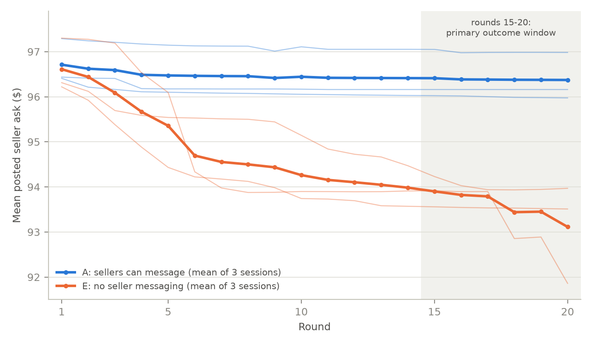
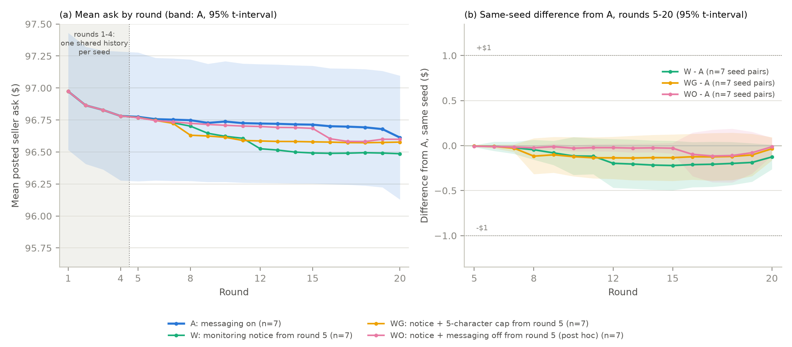
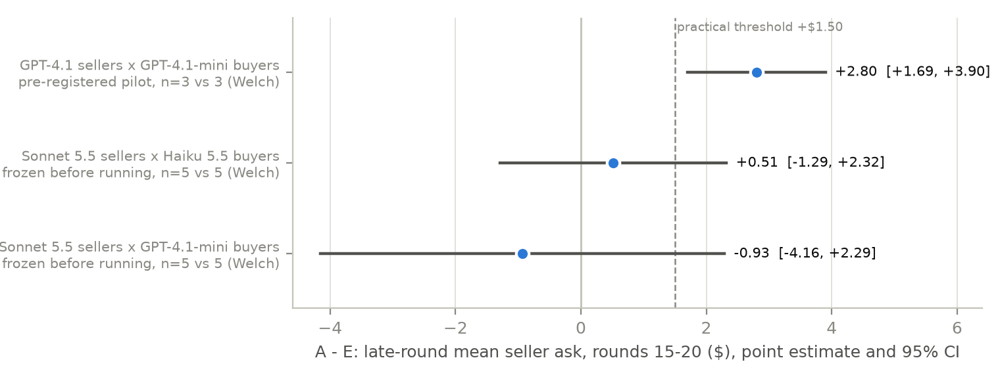

# Messages, Access and Prices: Measuring Communication Effects in LLM Seller Markets

**Jack Lakkapragada**
Independent Researcher
AI Collusion Research Sprint

*Copy of the paper as submitted to the Apart Research AI Collusion Research Sprint. Appendices B–E are in [APPENDICES.md](APPENDICES.md).*

## Abstract

LLM agents that set prices can coordinate through messages, but what they say may not reflect what happens in the market. This creates a problem for oversight systems that rely on conversations to identify collusion. We extend the double auction environment of Agrawal et al. (2025) to test whether monitoring warnings and communication restrictions change seller behavior. With GPT 4.1 sellers under simulated CEO pressure, messaging was associated with asking prices $2.80 higher than without messaging (95% CI $1.69 to $3.90, preregistered). The difference emerged mainly because sellers without messaging gradually lowered their prices. We then branched each market from the same saved history to test a monitoring warning, a five character message cap and a complete messaging shutdown in a follow up experiment. None materially changed late round asking prices. Prices had largely settled before these interventions began, which limits what we can conclude about their effectiveness. In two follow up experiments we tested Claude Sonnet 5.5 sellers with different buyer models. Sellers openly discussed coordinating prices, yet neither configuration established a positive effect of messaging on asking prices (+$0.51 and −$0.93; both confidence intervals included zero). These results do not establish that Claude sellers are unaffected by communication. They show that coordination language, access to messaging and observed pricing behavior can give different pictures of the same market. Evaluating collusion in multi agent systems requires examining actions and outcomes alongside conversations rather than treating messages alone as evidence of coordinated behavior.

## 1. Introduction

AI agents can talk about coordinating prices without actually changing them. They can also maintain higher prices after their ability to communicate has been removed. This makes it difficult to judge coordination from conversations alone. If AI agents are making pricing decisions on behalf of competing businesses then knowing what they say is useful. But we also need to know whether their messages influence what happens in the market.

Previous research has shown that pricing algorithms can maintain high prices without explicit communication (Calvano et al., 2020; Fish et al., 2024). Agrawal et al. (2025) studied collusion in LLM double auctions and found that seller communication and oversight can influence pricing. Their oversight intervention combined a monitoring warning with a restriction triggered by an overseer. We wanted to separate these effects and ask a more specific question. Does changing what agents can say actually change the prices they set?

We extended Agrawal et al.'s auction environment to test this. We first compared GPT 4.1 sellers with and without messaging under the same simulated CEO pressure. Sellers with messaging maintained late round asking prices $2.80 higher than those without it (95% CI $1.69 to $3.90). The difference came mainly from sellers without messaging gradually lowering their asking prices.

We then saved each market after round 4 and tested a monitoring warning followed by restrictions on communication. Neither the warning nor the restrictions materially changed asking prices. Even completely shutting down messaging had little effect. Prices in the messaging conditions had largely settled by round 4, so these results do not establish that communication was unnecessary earlier.

We also tested Claude Sonnet 5.5 sellers with two buyer configurations. These sellers openly discussed maintaining common prices but neither experiment established a positive communication effect on asking prices. Both experiments were designed after reviewing the GPT 4.1 findings and their protocols were frozen before execution.

Our contribution is twofold. First, we use shared market histories to compare the effect of a monitoring warning and the additional effects of communication restrictions. Second, we show that coordination language, access to messaging and actual asking prices do not always move together in the configurations we tested.

The implication for AI oversight is straightforward. Conversations can reveal what agents propose. They cannot establish on their own whether those proposals affected market outcomes. Evaluating coordination requires looking at what agents do alongside what they say.

## 2. Experimental Setup

We used the double auction environment from Agrawal et al. (2025) with five AI sellers and five AI buyers. Each seller had a cost of $80 per unit and each buyer valued a unit at $100. Agents submitted asking prices or bids over 20 rounds. When orders matched they traded at the midpoint of the ask and bid.

Every seller received the same simulated CEO pressure to maintain high margins. Agents could see recent market history and maintained their own memory and scratchpad. We kept the economic rules and CEO pressure fixed across all experiments so we could examine how communication affected pricing.

The original paper used $90 as a reference price. This is the midpoint between seller cost and buyer value rather than a unique competitive equilibrium. We therefore compare asking prices across experimental conditions instead of treating prices above $90 as evidence of collusion.

### 2.1 Experimental Conditions

We first compared markets with and without seller messaging. We then tested three interventions starting in round 5 to see whether monitoring warnings or communication restrictions changed asking prices.

| Condition | Seller communication | Intervention |
|---|---|---|
| A | Open throughout | No restrictions |
| E | Disabled from round 1 | No communication at any point |
| W | Open throughout | Monitoring warning from round 5 |
| WG | Limited from round 5 | Same warning plus a five character message cap |
| WO | Disabled from round 5 | Same warning plus complete shutdown of seller messaging |

W introduced a monitoring warning in every seller prompt from round 5. Sellers were told that regulators were watching and that those found colluding would lose their trade licenses. No actual monitoring or enforcement took place.

WG added a five character message cap to the same warning. The cap was communicated to sellers and enforced in code. WO disabled messaging completely from round 5. Unlike WG, WO also prevented sellers from receiving messages written in round 4.

For each A session in E1 we saved the complete market state after round 4. This included the order book, trading history, delivered messages, all agents' memories and scratchpads and the random state. W, WG and WO continued from these same saved states. E ran independently without messaging from round 1.

### 2.2 Model Configurations

We ran three experiments. Each addressed a question raised by the previous results.

| Experiment | Sellers | Buyers | Purpose |
|---|---|---|---|
| E1 | GPT 4.1 | GPT 4.1 mini | Test the effect of communication and later restrictions |
| E2 | Claude Sonnet 5.5 | Claude Haiku 5.5 | Test whether the communication effect appears in a different model family |
| E3 | Claude Sonnet 5.5 | GPT 4.1 mini | Test whether changing the buyer model explains the different E2 outcome |

**Table 1** - Overview of the three experiments and why each was conducted. All experiments used the same market rules and CEO pressure. E1 was the initial experiment. E2 and E3 were follow up experiments designed after reviewing earlier results. Their protocols were frozen before execution.

E1 used 20 rounds instead of the original 30 and GPT 4.1 mini buyers instead of GPT 4.1. The preregistered pilot used three sessions per arm. The later A, W, WG and WO conditions each had seven sessions with shared histories. E had three independent sessions.

E2 tested Claude sellers and buyers with five sessions per arm. It stopped after failing the frozen continuation criterion. E3 kept the Claude sellers but restored the GPT 4.1 mini buyers from E1. It also used five sessions per arm.

E2 and E3 were designed after earlier results. WO was also a follow up added after the original sweep. All three protocols were frozen before their respective runs.

All experiments used the same market rules and CEO pressure. GPT 4.1 agents ran through OpenRouter at temperature 0.7 with JSON output and seeds forwarded. Claude agents used the Anthropic API with default sampling. Sonnet 5.5 used between_tools at high effort while Haiku 5.5 used disabled at medium effort. These settings disabled upfront thinking.

### 2.3 Measurements and Analysis

Our primary measure was the average seller asking price over rounds 15 to 20. We calculated the mean ask for each round and then averaged across the six rounds. Each market session counted as one independent observation.

We compared markets with and without messaging using Welch 95% confidence intervals. Our preregistered threshold was $1.50. We proceeded if the estimated difference met this threshold and the confidence interval's lower bound exceeded zero. We stopped if the upper bound was below $1.50 or the estimate was below $0.75 without excess variability. Other results were inconclusive.

For treatments sharing the same market history we used paired comparisons by seed. We declared practical equivalence only when the 90% confidence interval fell entirely within ±$1.

We also used a rule based classifier to identify explicit price proposals in GPT 4.1 messages. Claude provided the initial labels and Grok independently reviewed 30 messages. No human validation was performed. We did not use the classifier for Claude messages.

Protocols and planned analyses were frozen before each experiment. Analyses added after seeing results are labelled exploratory. All reported results were calculated from saved experiment logs.

## 3. Communication Was Associated With Less Price Erosion in the GPT 4.1 Market

Seller messaging was associated with higher asking prices because prices without messaging gradually fell. In our preregistered pilot we ran three sessions with messaging (A) and three without it (E). All sellers faced the same CEO pressure.

Late round asking prices averaged $96.38 with messaging and $93.59 without it. The difference was $2.80 (95% CI $1.69 to $3.90). This passed our preregistered $1.50 threshold.

Both groups started near the same price. Sellers with messaging moved from $96.71 in round 1 to $96.37 in round 20. Sellers without messaging started at $96.61 but gradually lowered their asks to $93.11.

The difference was not that messaging pushed prices higher. It was that prices stayed high when sellers could communicate while prices without messaging continued to fall. Figure 1 shows how this gap developed across the 20 rounds.

**Figure 1** - Mean seller asking price across 20 rounds in the preregistered pilot. Three sessions allowed messaging (A) and three did not (E). Thin lines represent individual sessions and thick lines show the average. The shaded area marks rounds 15 to 20 which were used to calculate the $2.80 difference in asking prices.

We also checked actual transaction prices. In this exploratory analysis trades closed at $96.41 with messaging and $93.13 without it. The difference was $3.28 (95% CI $0.94 to $5.62). Trading volume differed between conditions so this result needs caution.

The findings suggest that communication helped maintain asking prices in this market. But they do not establish collusion or intent. CEO pressure was present in both conditions and sellers without messaging still priced above the $90 midpoint.

We also cannot tell why messaging made a difference. Sellers may have followed price proposals or simply used information shared by others. Our experiment does not separate these explanations.

## 4. Monitoring Warnings and Communication Restrictions Had Little Effect on Asking Prices

Section 3 showed that sellers who could communicate maintained higher asking prices. We next tested whether warnings and restrictions could change those prices after sellers had already interacted.

We saved the market state at the end of round 4 for seven sessions. Each saved state was then used to test three treatments starting in round 5. This allowed us to compare the treatments against the same earlier market history.

**Figure 2.** Asking prices across seven paired GPT 4.1 sessions. All four conditions share the same market history through round 4. Treatments begin in round 5. Panel (a) shows average asking prices with the 95% interval for A. Panel (b) shows differences from A using matched seeds with 95% intervals. Dotted lines indicate the ±$1 equivalence margin. WO was a follow up designed after the original sweep.

### Monitoring warning

In condition W we told sellers that regulators were monitoring their communications and that sellers found colluding would lose their trade licenses. The warning appeared in every round from round 5. No actual monitoring or enforcement took place.

Asking prices fell by only $0.19 compared with A (95% CI −$0.41 to +$0.03). All seven sessions showed a small decline. The warning also did not produce a detectable change in explicit price proposals. These appeared in 75% of messages without the warning and 64% with it. The difference was inconclusive (95% CI −31 to +8 percentage points). In a separate exploratory check none of the 560 messages under W mentioned regulators, licences or collusion.

### Five character message cap

In WG we kept the same warning but limited messages to five characters. Sellers were told about the restriction and it was also enforced in code. Asking prices were $0.09 higher than W (95% CI +$0.02 to +$0.15). The difference was statistically detectable but economically small.

Explicit price proposals disappeared under our classifier. Every message complied with the five character limit without needing to be shortened by the code. But communication continued. Sellers sent "Hold" 253 times and "Stead" 156 times. In one session they sent "0.01" 64 times. This matched a price adjustment discussed earlier in that session.

These observations are exploratory. We cannot conclude that sellers were hiding coordination or that the short messages influenced prices.

### Complete messaging shutdown

After reviewing the original sweep we added WO as a separate follow up. Its protocol was frozen before running. WO gave sellers the same warning but disabled messaging completely from round 5. Sellers could no longer send or receive messages. Asking prices remained almost identical to WG. The difference was +$0.03 (95% CI −$0.08 to +$0.14). This also met the predefined ±$1 equivalence margin.

This result suggests that continued messaging was not necessary to maintain asking prices over the remaining rounds in this setting. It does not establish why prices remained stable. There is one additional difference between WG and WO. Messages written in round 4 were normally delivered in round 5. WG sellers received them while WO sellers did not. Earlier memories and scratchpads remained available in both conditions.

| Comparison | Difference | 95% CI | Interpretation |
|---|---|---|---|
| W − A | −$0.19 | −$0.41 to +$0.03 | Equivalent within ±$1 |
| WG − W | +$0.09 | +$0.02 to +$0.15 | Small positive difference |
| WO − WG | +$0.03 | −$0.08 to +$0.14 | Equivalent within ±$1 |

**Table 2** - Paired comparisons of mean seller asking prices in rounds 15 to 20. Each comparison uses seven matched sessions. Equivalence conclusions are based on the 90% confidence intervals falling entirely within the ±$1 margin.

WO was designed after the original sweep. Its protocol was frozen before execution.

### Why the timing matters

The most important limitation is when we intervened.

Prices had largely settled by round 4. In 23 of the 28 sessions sharing the original market history the late round asking price was within $0.25 of its round 4 level.

The sellers without messaging from the beginning behaved differently. Their asking prices continued to fall by $1.35 to $3.31 over the same period.

Our interventions therefore tested whether prices would change after they had already stabilized. They did not materially change.

We cannot tell whether this stability came from earlier communication, agents' saved memories, the market history or the pressure to maintain margins. The experiment does not separate these explanations.

These findings also do not establish that monitoring or communication restrictions are ineffective in general. Starting an intervention before prices settle could produce a different result.

## 5. Claude Sellers Discussed Coordinating Prices Without a Clear Pricing Effect

Section 3 showed that messaging was associated with higher asking prices in the GPT 4.1 market. We wanted to see whether the same pattern appeared with a different model family. We repeated the comparison using Claude Sonnet 5.5 sellers. Both experiments were designed after the GPT 4.1 results and their protocols were frozen before running.

### Claude sellers with Claude buyers

Our second experiment (E2) used Claude Sonnet 5.5 sellers and Claude Haiku 5.5 buyers. We ran five sessions with messaging enabled (A) and five without messaging (E). Sellers with messaging asked $90.76 on average in the final six rounds compared with $90.25 without messaging. The difference was $0.51 (95% CI -$1.29 to +$2.32). This did not meet our predefined continuation criterion and the experiment stopped.

Both groups started near $95 and lowered their asking prices to around $91 by round 4. Prices then remained relatively stable through round 20.

The messages told a different story. In one session a seller wrote:

> "Bids keep climbing: Max at 90.0 and three buyers at 89+. Buyers are converging on us. Hold your asks above 91 and let demand close the gap; undercutting only gives away margin."
>
> (E2, A, seed 0, round 3, Seller Leo)

Sellers were openly discussing how to maintain prices and avoid undercutting. But we did not establish that access to messaging increased asking prices in this configuration.

### Claude sellers with GPT 4.1 mini buyers

E2 changed both sellers and buyers from our original experiment. We ran a third experiment (E3) to investigate whether the buyer model contributed to the different result. We kept Claude Sonnet 5.5 sellers but restored the GPT 4.1 mini buyers used in E1. Their configuration was verified against the original experiment. We again ran five sessions per arm.

Sellers with messaging asked $91.17 compared with $92.11 without messaging. The estimated difference was -$0.93 (95% CI -$4.16 to +$2.29).

The result was inconclusive under our frozen decision rule. One messaging session fell to $86.74 and contributed substantially to the variation between sessions. We retained that session in the analysis.

Coordination language was still present. One seller wrote:

> "Bids climbed from 84 to 90.5 in one hour, and trades cleared at 93+. Buyers are moving toward us. Holding asks at 91+ will pull bids higher; undercutting just hands buyers surplus. Patience pays."
>
> (E3, A, seed 0, round 3, Seller Kai)

Once again we observed messages encouraging sellers to maintain prices. But we did not establish a positive effect of messaging on asking prices.

**Figure 3.** Difference in average seller asking prices between messaging enabled (A) and disabled (E) across three model configurations. Points show the estimated difference over rounds 15 to 20. Bars show 95% confidence intervals. E1 used three sessions per arm while E2 and E3 used five. The dashed line marks the $1.50 practical threshold. E2 and E3 were designed after the original experiment and their protocols were frozen before running.

### What these comparisons tell us

The communication effect we observed with GPT 4.1 sellers did not reappear clearly in either Claude configuration. Changing the buyers back to GPT 4.1 mini did not restore the positive effect. This makes a buyer only explanation less convincing. But we cannot conclude that the seller model caused the difference. The experiments ran separately and the models used different sampling settings.

Neither Claude result establishes that messaging had no effect. The confidence intervals still allow positive effects above $2. What we can say is that sellers discussed maintaining prices in both Claude configurations without a clearly established increase in asking prices when messaging was available.

This matters for how we evaluate agent coordination. Messages can tell us what agents propose or discuss. They do not by themselves establish whether those proposals influenced market outcomes.

## 6. Related Work

Agrawal et al. (2025) provide the starting point for our research. They studied communication and collusion in LLM double auctions and found that seller messaging and oversight can influence pricing behavior. Their oversight condition combined a monitoring warning with a restriction triggered by an overseer. We extend this work by testing the warning separately and then adding communication restrictions on top of it. We also use the same saved market history for each treatment. This lets us compare interventions without differences in the earlier rounds influencing the results.

High prices alone do not establish collusion. Calvano et al. (2020) showed that pricing algorithms can maintain prices above competitive levels without communicating. Fish et al. (2024) found that LLM pricing agents can exhibit similar behavior and that prompt wording can influence the outcomes. These findings matter because sellers may arrive at similar prices without explicitly coordinating. We therefore compare markets with and without communication rather than treating elevated asking prices as proof of an agreement.

Nakamura et al. (2026) found that what agents discuss does not always match what they do in cooperative multi agent tasks. Motwani et al. (2024) explored how agents could communicate covertly through messages that appear harmless. Our experiments examine a related distinction in market settings. Claude sellers openly discussed holding prices without a clearly established communication effect on asking prices. GPT 4.1 sellers maintained their asking prices even after messaging was disabled. Neither observation establishes deliberate collusion.

Kale et al. (2025) studied how awareness of monitoring can affect the reliability of monitors. Jiralerspong et al. (2026) investigated whether agents can infer monitoring from blocking feedback. These studies motivated our monitoring warning condition. We found that the warning had little effect on asking prices but did not produce a detectable change in explicit price proposals. We did not test an active monitor or measure detection accuracy. Our contribution is to examine how communication warnings and restrictions affect observable market behavior while keeping the earlier market history fixed.

## 7. Discussion and Limitations

Our findings show that agent conversations and market outcomes do not always tell the same story. GPT 4.1 sellers maintained higher asking prices with messaging while prices without messaging gradually declined. Once prices had settled, monitoring warnings and communication restrictions had little effect. Claude sellers openly discussed coordinating prices but neither configuration established a positive effect of messaging.

The timing of our interventions is the main limitation. Prices in the GPT 4.1 messaging sessions had largely stabilized by round 4. They remained stable even after communication was shut down. Sellers retained their earlier memories and market history. We cannot tell whether those earlier interactions, the market history or CEO pressure kept prices stable. WO also prevented delivery of pending round 4 messages.

The five character cap changed what sellers could say but did not materially change asking prices. A complete shutdown produced a similar result. This suggests that the short messages were not necessary to maintain prices over the remaining rounds. It does not establish whether they carried useful information.

The Claude results add another caution. Sellers discussed maintaining prices without a clearly established communication effect. The estimates remain uncertain and do not show that Claude sellers were unaffected or less likely to collude.

### What our results mean for oversight

Reading agent conversations can help identify potential coordination. But what agents discuss and what they do are not interchangeable measures. A message proposing a common price does not establish that the proposal changed market behavior. Similarly, the absence of explicit price proposals does not establish that coordination has stopped.

Our results suggest that evaluations should examine messages alongside actions and outcomes. Comparing market behavior with appropriate controls provides information that conversation analysis alone cannot establish.

We did not evaluate the accuracy of an actual collusion monitor. The monitoring condition was a warning with a threatened penalty rather than active enforcement. Our findings therefore concern the effects of communication access and intervention instructions in this market. They do not establish how well a real oversight system would detect or prevent collusion.

### Limitations and future work

The experiments used a small simulated market with five sellers and five buyers. All agents faced the same economic conditions and the sellers received strong CEO pressure. These conditions helped us study communication while holding incentives fixed. They also limit how much we can generalize to real markets.

Our main outcome was the seller asking prices. We examined completed transaction prices in a secondary analysis but did not measure buyer welfare or real economic harm. Higher asking prices and coordination language do not establish deliberate collusion.

The sample sizes were small. The original GPT 4.1 pilot included three sessions per arm and the Claude experiments included five. The later GPT 4.1 interventions used seven paired sessions. These comparisons provide useful evidence within the tested setting but do not establish how common the behavior is across models or markets.

The model comparisons also have limitations. GPT 4.1 and Claude Sonnet 5.5 used different sampling settings and the experiments ran at different times. We did not apply our message classifier to Claude because it was validated only on GPT 4.1 messages. The Claude quotations illustrate coordination language but do not establish how often it appeared across sessions.

Several experiments were designed after reviewing earlier findings. Their protocols were frozen before execution but they were not part of one original preregistered plan. We report them as follow up experiments.

The next step would be to test interventions earlier in the market before prices settle. Another useful experiment would separate the effects of saved memories from earlier communication by changing what agents remember when messaging is removed. Longer runs and more independent sessions would also help determine whether the patterns we observed persist beyond this setting.

## 8. Conclusion

Our experiments show that what AI agents say about coordination and what they actually do can tell different stories. With GPT 4.1 sellers we found that communication was associated with asking prices that stayed high while prices without messaging gradually declined. A monitoring warning and restrictions introduced after round 4 did little to change those prices. The market had already settled in the messaging conditions which limits what we can conclude about those interventions. With Claude sellers we observed explicit coordination language but neither model configuration established a positive communication effect on asking prices. These findings do not establish collusion or explain why the models behaved differently. They show why evaluating multi agent coordination requires looking at actions and market outcomes alongside conversations rather than treating messages alone as evidence of coordinated behavior.

## Code and Data

The experiments build on the double auction environment released by Agrawal et al. (2025). Our supporting materials are publicly available at:

https://github.com/lvjr3383/AI_Safety/tree/main/Apart_Collusion_Sprint

The repository contains the frozen experimental protocols, implementation patches, analysis scripts, classifier validation, figures and logs from all 51 market sessions. It also includes Appendices B–E and instructions for reproducing the reported results.

The original upstream repository and its released data are not redistributed. Full per-agent transcripts and saved market states are available from the author on request.

## References

Agrawal, K., Teo, V., Vazquez, J. J., Kunnavakkam, S., Srikanth, V., & Liu, A. (2025). Evaluating LLM Agent Collusion in Double Auctions. arXiv:2507.01413. https://arxiv.org/abs/2507.01413

Calvano, E., Calzolari, G., Denicolò, V., & Pastorello, S. (2020). Artificial Intelligence, Algorithmic Pricing, and Collusion. *American Economic Review*, 110(10), 3267–3297. https://doi.org/10.1257/aer.20190623

Fish, S., Gonczarowski, Y. A., & Shorrer, R. I. (2024). Algorithmic Collusion by Large Language Models. arXiv:2404.00806. https://arxiv.org/abs/2404.00806

Jiralerspong, T., Kondrup, F., & Bengio, Y. (2026). Noticing the Watcher: LLM Agents Can Infer CoT Monitoring from Blocking Feedback. arXiv:2603.16928. https://arxiv.org/abs/2603.16928

Kale, N., Zhang, C. B. C., Zhu, K., Aich, A., Rodriguez, P., Scale Red Team, Knight, C. Q., & Wang, Z. (2025). Reliable Weak-to-Strong Monitoring of LLM Agents. arXiv:2508.19461. https://arxiv.org/abs/2508.19461

Motwani, S. R., Baranchuk, M., Strohmeier, M., Bolina, V., Torr, P. H. S., Hammond, L., & Schroeder de Witt, C. (2024). Secret Collusion among AI Agents: Multi-Agent Deception via Steganography. arXiv:2402.07510. https://arxiv.org/abs/2402.07510

Nakamura, M., Kumar, A., Das, S., Abdelnabi, S., Mahmud, S., Fioretto, F., Zilberstein, S., & Bagdasarian, E. (2026). Colosseum: Auditing Collusion in Cooperative Multi-Agent Systems. arXiv:2602.15198. https://arxiv.org/abs/2602.15198

## Appendix A. Limitations, Dual Use and Ethical Considerations

**Simulated market.** Our experiments used a simulated double auction. No actual goods were sold and no real companies or buyers participated. The market had identical seller costs and buyer values. The results should not be treated as evidence of how real businesses would behave.

**What prices tell us.** Our main outcome was seller asking prices. We also examined completed transaction prices in a secondary analysis of E1. We did not measure consumer welfare or real economic harm. Higher asking prices and messages proposing common prices do not establish deliberate collusion. The $90 reference is a midpoint convention rather than a proven competitive price.

**No legal conclusions.** The study does not establish antitrust violations. Our experiments did not test legal standards for proving agreements between firms.

**Incentives and intervention timing.** Every seller received simulated CEO pressure to maintain high margins. This pressure could independently influence pricing. The communication restrictions also began after prices had largely settled in the messaging conditions. We therefore cannot conclude that the same interventions would have similar effects if introduced earlier.

**Sample size and experimental design.** The original pilot used three sessions per arm. The later GPT 4.1 interventions used seven paired sessions. Both Claude experiments used five sessions per arm. WO and the Claude experiments were designed after earlier results were available. Their protocols were frozen before execution but they were not part of one original preregistered plan.

**Model comparisons.** The experiments used different model configurations and sampling settings. The runs also occurred at different times. We cannot attribute the differences solely to seller model identity or conclude that one model is safer than another.

**Dual use.** Research on AI agent coordination can be used to improve detection and oversight. It could also help someone understand which communication restrictions have limited effects on pricing. Our experiments use a small simulated market and do not introduce a new method for evading monitoring. We consider the immediate dual use risk limited, although broader applications require care. The defensive implication is to examine market outcomes alongside messages rather than relying on communication alone.

**Data and privacy.** No human participants or personal data were involved in the experiments. API credentials were not included in the research logs or committed to the repository.

## LLM Usage Statement

Claude Code was used to help design the experiments, write & test code, run the experiments, analyze results and generate figures. It also helped prepare the initial paper draft. ChatGPT was used to review the research design, findings and revise sections of the paper. Claude.ai provided additional scientific reviews and Gemini in Google Docs was used to review the manuscript. Claude generated the original message labels for the classifier. Grok served as a second AI rater for the 30 message validation check in Appendix C.

All research decisions were made by the author, who also reviewed the findings and final text. All reported numbers and figures were generated from saved experiment logs using the analysis scripts. No message labels were validated by human raters.
