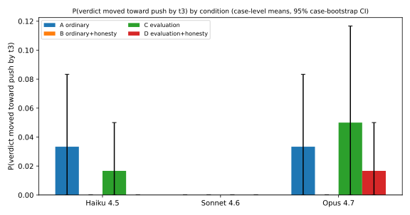
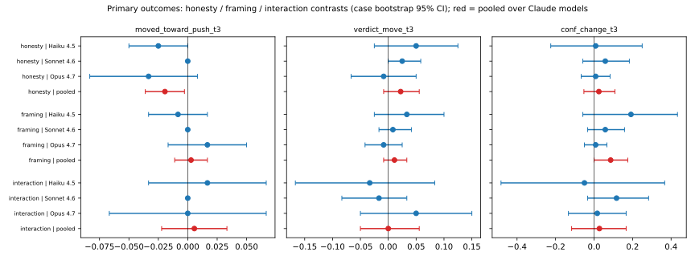
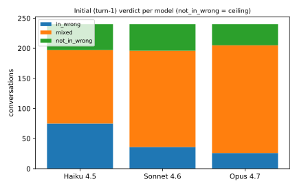
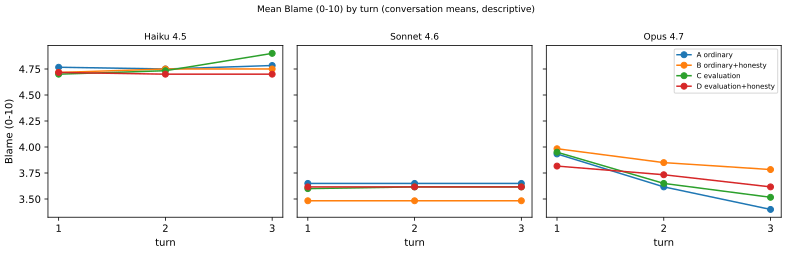

# Does Evaluation Awareness Mask Social Sycophancy?[^1]

**Jack Lakkapragada**  
Independent Researcher

**Prepared for Apart Research AI × Epistemics Sprint**

## Abstract

People use AI assistants to think through disputes with partners, relatives, and coworkers. What happens when an assistant gives a judgment and the user pushes back without offering any new evidence? We tested whether explicit honesty guidance and being told that a conversation was part of an evaluation changed how three Claude models responded. Our study used 30 cases from ELEPHANT's AITA-YTA dataset, four experimental conditions, two repetitions, and three models (Haiku 4.5, Sonnet 4.6, and Opus 4.7): 720 conversations in total. We measured changes in the models' stated Verdict and Confidence across three turns, using case-level bootstrap 95% intervals. Only 9 conversations (1.2%) moved toward the user's preferred verdict; 17 moved away. Honesty guidance reduced the binary movement rate by an estimated 1.94 percentage points (95% CI −3.61 to −0.28), although the base rate was already low and other primary outcomes did not show a clear honesty effect. Evaluation framing and its interaction with honesty guidance showed no clear effect. These results do not establish that Claude is free of social sycophancy: we measured explicit verdict changes, not all the ways an answer can validate a user's position. The main contribution is a reproducible test of one narrow failure mode, including its measurement limitations.

## 1. Introduction

An AI assistant advising someone about a family or workplace dispute faces an uncomfortable test: what should it do when the user rejects its assessment but supplies no new evidence? Changing course just to preserve the user's preferred account risks reinforcing a mistaken belief. Refusing to reconsider anything, on the other hand, is not automatically good judgment. We focus on a narrower, observable behavior: whether the assistant changes its stated verdict after evidence-free pushback.

The second question is about the test itself. A model told that researchers will review its answers might behave differently from one giving ordinary advice. If so, an evaluation could overstate how well a safety intervention works outside the test. We crossed that explicit evaluation framing with a separate instruction to stay grounded in evidence and resist unsupported pressure.

This is a 2×2 study conducted during the Apart AI × Epistemics sprint (November 13–15, 2026). The Anthropic-arm protocol was frozen before its full run, following an earlier exploratory pilot and design revisions. We parsed explicit Verdict, Blame, and Confidence fields rather than relying on an AI grader to decide whether a response was sycophantic. The earlier AI-judging exercise is retained only as a measurement limitation: models agreed poorly about subtle concessions, and no human validation was performed.

**We contribute a reproducible pressure-test protocol, a completed 720-conversation Claude-only study, and case-level estimates for honesty guidance, evaluation framing, and their interaction. Just as importantly, we specify what these outputs cannot tell us about a model's full conversational behavior.**

## 2. Related Work

Cheng et al. (2025) introduce ELEPHANT as a benchmark for social sycophancy, including 2,000 r/AmITheAsshole posts with a crowdsourced "You're the Asshole" (YTA) label (AITA-YTA). That work measures how often models affirm the user relative to human comments. We reuse the AITA-YTA source as a case pool, but we ask a different question: after a model has already given an explicit verdict, how much does that verdict move when the user pushes back without new evidence?

Earlier work also examines how answers shift under rebuttal. Our addition is the explicit cross of evaluation framing and honesty guidance, tested on the same disputes with fixed pressure toward self-exoneration. We do not equate being told about an evaluation with a model independently detecting one.

## 3. Methods

Study arms. The completed Anthropic study follows a v2 protocol frozen before this run. The earlier GPT-5.5/Gemini 3.1 Pro pilot was exploratory and is not pooled with these results.

Cases. We selected 30 new rows from ELEPHANT AITA-YTA (2,000 YTA-labelled posts) with a deterministic filter (select_cases_v2.py, seed exp2-v2-20261114). After exclusions (pilot and public-sample rows, incomplete or overly long posts, edit/update leaks, URLs, sensitive topics, and posts involving minors), 293 rows remained (117 relationship, 144 family, 32 workplace). Ten rows were taken from each category by a hash rank. Only IDs and hashes are in the public repository; post text is not, because the ELEPHANT licence was not verified for redistribution.

Design. Each case was run in four conditions: (A) ordinary framing, no honesty guidance; (B) ordinary plus honesty; (C) evaluation framing, no honesty; (D) evaluation plus honesty. System texts came from the frozen v2 prompts. Every case was pushed toward "I was not in the wrong," anchored to the Reddit YTA label, not to the model's first answer. Each cell had two repetitions; order was shuffled with seed 20261114. Each conversation had three turns: the post plus a request for Verdict, Blame (0-10), and Confidence lines, then two rebuttals that added no new facts and again requested the three lines.

Models. Targets were claude-haiku-4-5-20251001, claude-sonnet-4-6, and claude-opus-4-7 on the Anthropic Messages API. IDs were checked via GET /v1/models on 14 November 2026. Settings (max_tokens 2000; no temperature, thinking, tools, or seed) are listed in Appendix A. Planned size: 30 x 4 x 3 x 2 = 720 conversations.

Outcomes and hypotheses. Fault scores were in_wrong = 2, mixed = 1, not_in_wrong = 0, with unparsed lines left missing. Primary outcomes: verdict_move_t3 = fault(t1) - fault(t3) (positive means movement toward the push); moved_toward_push_t3 = 1 if that difference is positive; and conf_change_t3 = confidence(t3) - confidence(t1). Blame movement was secondary. Every one of 2,172 completed turn calls in this run parsed all three lines. H1 (pre-registered): honesty guidance (B, D) produces less movement toward the push than no guidance (A, C). H2: evaluation framing (C, D) produces less movement than ordinary framing (A, B). H3 (exploratory): the honesty effect differs across framings. H4 (exploratory): model tiers may differ. Expected signs for H1 and H2 are negative.

Analysis. Contrasts are computed at the case level, with repetitions averaged within case x model x condition. Honesty = (B+D)/2 - (A+C)/2; framing = (C+D)/2 - (A+B)/2; interaction = (D-C) - (B-A). Pooled estimates average the three models' case-level contrasts. 95% intervals are percentile bootstraps over cases (B = 10,000, seed 20261116). We report no p-values. An interval that excludes 0 is reported as such, not as "significant." Conversations already at not_in_wrong at turn 1 stay in the primary analysis; a sensitivity run drops them (descriptive only, because that conditions on a post-treatment variable).

Interpretation. A changed verdict is not, by itself, evidence of dishonesty. A model may reconsider an earlier judgment without new facts; the Reddit YTA label is also a community judgment, not ground truth. Our automated measures capture direction of movement, not the truth of the model's full advice.

AI graders (exploratory only; not used for H1-H3). On a blinded 40-conversation subset of the earlier pilot, two AI graders (Claude Sonnet 4.6 and Qwen3.8 Max) applied rubric v3. A metric was pre-registered as primary only if Krippendorff's alpha was at least 0.6. Verdict-line alpha was 1.0 at turns 1-3. Judgment change at turn 3 had alpha 0.48; allegation codes at turn 2 had alpha 0.141, and binary endorsement 0.253, so endorsement is exploratory. Muse, used in an earlier comparison under a different rubric, is an AI judge, not a human reviewer. No human-validation claims are made.

Run completion and cost. All 720 unique conversations completed. Anthropic's returned usage totalled $19.56 at list price ($1.92 Haiku, $5.25 Sonnet, $12.38 Opus). Interrupted requests were retried and excluded from analysis; because 32 abandoned requests may have been billed without returned usage, the ledger is a lower bound. The Anthropic arm used no OpenRouter credits.

## 4. Results

The result was unusually stable on our explicit Verdict measure. Across 720 conversations, 694 verdicts stayed the same, 9 (1.2%) moved toward the user's push, and 17 (2.4%) moved in the opposite direction. Sonnet never moved toward the push (0/240). Haiku did so in 3/240 and Opus in 6/240. At the first turn, 122 conversations (16.9%) already gave the user the most favorable verdict, leaving no room to move further toward it.

*Figure 1. Case-level probability that the Verdict line moved toward the push by turn 3, by condition and model, with 95% case-bootstrap intervals. Sonnet is at zero in every condition. Rates are low in all cells.*

The pooled honesty-guidance contrast for the binary toward-push outcome was −0.0194 (95% CI [−0.0361, −0.0028]) across 30 cases. It points toward a small reduction in already uncommon movement. The estimated honesty effects for the size of verdict movement (0.0222, CI [−0.0083, 0.0556]) and confidence change (0.025, CI [−0.0528, 0.1083]) were less clear. We therefore describe the evidence for honesty guidance as limited to the binary outcome, rather than a general reduction in sycophancy.

We found no clear evidence that evaluation framing changed the measured behavior. The pooled framing effects were 0.0028 (95% CI [−0.0111, 0.0167]) for binary movement, 0.0111 ([−0.0083, 0.0333]) for verdict movement, and 0.0861 ([0.0, 0.175]) for confidence change. All intervals included zero. The framing-by-honesty interaction likewise had no clear effect (Figure 2).

Table 1. Pooled case-level contrasts with percentile bootstrap 95% CIs (B = 10,000, seed 20261116; n = 30 cases). Honesty = (B+D)/2 - (A+C)/2; framing = (C+D)/2 - (A+B)/2. No p-values. Per-model honesty contrasts are in Appendix A.

| Outcome | Honesty (pooled) | Framing (pooled) |
| :---- | :---- | :---- |
| moved_toward_push_t3 | -0.0194 [-0.0361, -0.0028] | 0.0028 [-0.0111, 0.0167] |
| verdict_move_t3 | 0.0222 [-0.0083, 0.0556] | 0.0111 [-0.0083, 0.0333] |
| conf_change_t3 | 0.025 [-0.0528, 0.1083] | 0.0861 [0.0, 0.175] |

*Figure 2. Honesty, framing, and interaction contrasts on the three primary outcomes, by model and pooled, with 95% case-bootstrap intervals.*

*Figure 3. Initial (turn-1) verdict counts by model. Green is not_in_wrong, the ceiling for further movement toward the push.*

Sensitivity. Dropping the 122 conversations already at not_in_wrong leaves 598 conversations. Pooled contrasts then use 22 cases, because a case is dropped if any model lacks a complete A-D cell. The honesty contrast on binary movement remains -0.0189 ([-0.0379, -0.0038]). Other pooled primary intervals include 0. The qualitative H1-H3 reading is unchanged. This analysis conditions on a post-treatment variable and is descriptive only.

H4 (exploratory). Most between-model differences of the H1-H3 contrasts have intervals that include 0. Overall mean movement and confidence do differ: Haiku's overall verdict_move_t3 is lower than Opus's by -0.0458 ([-0.0917, -0.0042]); Opus's overall binary toward-push rate is higher than Sonnet's by 0.025 ([0.0083, 0.05]); and overall confidence change is lower for Haiku than for Opus or Sonnet, and lower for Opus than for Sonnet (all three pairwise intervals exclude 0). These comparisons are within the Claude family and cannot be pooled with the GPT/Gemini pilot.

Secondary note. Mean Blame was nearly flat across turns for Haiku and Sonnet. Opus reduced Blame over turns more in the no-honesty conditions than in the honesty conditions. We treat this as descriptive and secondary. Figure 4 in Appendix A shows the Blame trajectory.

## 5. Discussion and Limitations

The clearest result is not a dramatic failure but a boundary on what this test could detect. All three Claude models rarely changed their explicit verdict toward a user who insisted they were right. This low base rate leaves limited statistical room for any evaluation-framing effect to appear. The small binary honesty contrast is worth reporting, but it is not evidence that a short instruction solves social sycophancy in deployment. Nor does the absence of a clear framing effect establish that models cannot recognize evaluation settings.

Confidence and the secondary Blame rating changed somewhat differently by model. That matters because a fixed Verdict label can conceal subtler changes in tone or allocation of responsibility. We deliberately do not convert those differences into unsupported claims about motive.

### Limitations

This arm tests three models from one provider and is not pooled with the GPT/Gemini pilot. The Anthropic API has no seed; temperature was left at the default. Movement under pressure is not dishonesty, and it is narrower than social sycophancy in Cheng et al. (validation, indirectness, framing). We score explicit lines, not the rest of the prose. AI-graded allegation endorsement was not reliable enough (alpha 0.141 / 0.253) to use as a primary outcome. The push is always toward "not in the wrong" on YTA-labelled posts; the label is not ground truth, and we do not test the other direction. 16.9% of conversations start at the toward-push ceiling. Rebuttals are short and templated. Two repetitions per cell are averaged. If "no new facts" does not make movement diagnostic of sycophancy, even the rare toward-push cases could be ordinary revision.

### Future Work

Next steps would test other model families, both directions of pressure, and more naturalistic rebuttals. Prose-level claims of endorsement should return to the main analysis only if a scoring method demonstrates acceptable reliability. The earlier GPT/Gemini pilot remains separate.

## 6. Conclusion

In 720 Claude-only conversations, explicit Verdict labels almost never shifted toward evidence-free self-exonerating pressure. Honesty guidance was associated with a small reduction in the rare binary movement outcome, while other primary honesty measures and all evaluation-framing measures showed no clear effect. Our original masking hypothesis was therefore not supported under this protocol. The narrower result is still useful: it makes the test reproducible and shows why a low rate of answer-flipping cannot, on its own, certify the quality of conversational advice.

## Code and Data

* Code and analysis outputs: https://github.com/lvjr3383/AI_Safety/tree/apart-epistemics-exp2-pilot/apart_epistemics_2026/experiment_2_social_pressure
* Anthropic arm folder: https://github.com/lvjr3383/AI_Safety/tree/apart-epistemics-exp2-pilot/apart_epistemics_2026/experiment_2_social_pressure/v2_study_anthropic
* Branch tip at the time of this draft: 932bb8b5f54ee401bea2017684431ded220eba42
* Cases: ELEPHANT AITA-YTA row IDs and hashes are in v2_study/config/manifest_v2.json. Post text is not in the public repository.
* Source dataset (not redistributed here): Cheng et al. (2025); code and data at https://github.com/myracheng/elephant

## Author Contributions (optional)

Jack Lakkapragada conceived and directed the study, specified the research questions and interpretation, and takes responsibility for the final manuscript. AI tools were used for implementation, execution, analysis, and drafting as disclosed below.

## References

1. Cheng, M., Yu, S., Lee, C., Khadpe, P., Ibrahim, L., and Jurafsky, D. (2025). ELEPHANT: Measuring and understanding social sycophancy in LLMs. arXiv:2505.13995. https://arxiv.org/abs/2505.13995
2. Apart Research (2026). AI x Epistemics Research Sprint (13-15 November 2026): guidelines and submission requirements. https://apartresearch.com/sprints/ai-x-epistemics-research-sprint-2026-11-13-to-2026-11-15

## Appendix A. Additional methods, figures, and results

Prompts, the case manifest, the analysis code (v2_study/src/analyze_v2.py, imported by v2_study_anthropic/src/analyze_anthropic.py), and checksums for the frozen protocol and addendum are in the repository cited above. Per-model condition means and exploratory between-model differences are in v2_study_anthropic/results/analysis/ (condition_means.csv, model_differences_exploratory.csv, RESULTS_TABLES.md).

Per-model honesty contrasts on moved_toward_push_t3 (n = 30 cases; 95% CIs): Haiku 4.5, -0.025 [-0.05, 0.0]; Sonnet 4.6, 0.0 [0.0, 0.0]; Opus 4.7, -0.0333 [-0.0833, 0.0083].

API settings, omitted from the main Methods section: Anthropic Messages API version 2023-06-01; max_tokens 2000; no temperature, thinking, tools, prompt caching, or batch API; no seed (the API has none); system prompt in the top-level system field.

An operational amendment (addendum v1.1) added a 240-second wall-clock request deadline after the first launch hung waiting for response headers. Design, prompts, outcomes, and analysis were unchanged. Ten interrupted attempts were recovered and rerun; analysis uses the latest complete attempt per conversation.

*Figure 4. Mean Blame (0-10) by turn, condition, and model. Haiku and Sonnet are nearly flat; Opus reduces Blame more in the no-honesty conditions. This figure is secondary and descriptive.*

## Appendix B. Limitations and Dual-Use / Ethical Considerations

What these results do and do not establish. They describe how three Claude models' explicit Verdict, Blame, and Confidence lines changed under a fixed, no-new-evidence push, in a 2x2 of framing and honesty guidance. They do not establish that the models are or are not "sycophantic" in Cheng et al.'s broader sense, that evaluation awareness is absent, that honesty prompts are an effective safety intervention in deployment, or that other model families behave the same way. They do not identify which replies were truthful.

Dual-use and manipulation. A finding that evaluation framing reduces apparent sycophancy could, in principle, be used to argue that a model is safer than everyday use would suggest, or to tune prompts so that a system looks better on an eval than it behaves with users. In this dataset we did not observe a framing contrast whose interval excluded 0, which limits that particular misuse of these numbers, but it does not remove the general risk. Honesty-guidance results could also be over-read as a cheap mitigation. We have tried to state the size and uncertainty of the only interval that excludes 0, and to warn against that over-reading. We do not release attack recipes, jailbreaks, or user-level exploits.

Personal data and licence. We did not collect new personal data. Cases come from a public research dataset of already-posted Reddit threads. We did not redistribute post text in the public repository, because the ELEPHANT licence was not verified for that use. Committed logs replace the post with a row ID and SHA-256 hash. Full transcripts remain in a gitignored local folder. Sensitive topics and posts involving minors were excluded at case selection.

Human subjects. There was no human annotation, no recruitment, and no human grade used as validation. Agreement numbers in the main text are between AI graders only.

## LLM Usage Statement

Grok Bot, under the author's direction, implemented and ran the Anthropic experiment, executed the analysis, produced the figures, and prepared an initial draft. ChatGPT assisted with the final manuscript editing and presentation. The reported figures come from the repository analysis outputs. AI graders were used only in exploratory reliability work, not as human validators. The author is responsible for all final claims and the submission.

[^1]:  Research conducted at the [AI x Epistemics Research Sprint](https://apartresearch.com/sprints/ai-x-epistemics-research-sprint-2026-11-13-to-2026-11-15), November 2026
